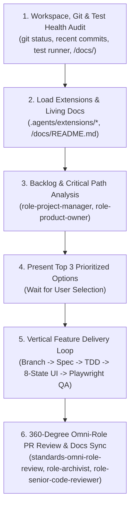

# `continue-project` Master Resume & Execution Orchestrator (`continue-project`)

## Mission
Provide a deterministic, zero-guesswork entry point whenever resuming work on an existing repository. Audit workspace health, synchronize with `<workspace>/docs/` and `<workspace>/.agents/extensions/`, evaluate backlog dependencies along the critical path, present the top prioritized next actions for user confirmation, and drive the selected task through TDD, UI craft, QA verification, and 360-degree PR review.

---

## Activation & Cross-Linking Protocol

Whenever `continue-project` is activated:
1. **Load Project Governance & Extensions (`Rule C` & `Rule D`)**:
   - Read `<workspace>/AGENTS.md`, `<workspace>/docs/README.md`, and scan `<workspace>/.agents/extensions/` to restore full project context and custom rules before touching any code.
2. **Enforce Sequential Lifecycle Gates (`project-lifecycle`)**:
   - Verify which lifecycle phase the project is currently in. If foundational artifacts (e.g., `/docs/domain/`, ADRs, `standards-web-essentials` audit, or design tokens) are missing, recommend completing those upstream foundations before building downstream UI features.



---

## Step-by-Step Resume Sequence

### Step 1: Workspace, Git & Test Suite Health Audit
Inspect the physical state of the repository before proposing new work:
1. **Git State Check**:
   - Run `git status --short --branch` to detect uncommitted work, untracked files, or an in-progress feature branch.
   - Run `git log -n 5 --oneline` to inspect recent completed deliverables.
2. **Open PRs & Issues Check**:
   - Check `gh pr list --state open` and `gh issue list --state open --limit 30` (or local backlog docs if offline).
3. **Build & Test Smoke Check**:
   - Verify whether typechecking and existing tests are currently green or if an interrupted task needs immediate repair.

### Step 2: Backlog & Critical Path Dependency Analysis
Using `role-project-manager` and `role-product-owner`:
1. Filter open issues by milestone and priority (`priority: p0-critical`, `priority: p1-high`).
2. Verify **Definition of Ready (DoR)** and **Upstream Dependencies**:
   - Never recommend starting a downstream screen if its database migration, API contract, or design token dependency is still unbuilt.
   - Flag any issue sized `L` or `XL` that requires decomposition before coding.
3. Check for unaddressed regressions, security advisories, or broken CI checks (which always take `P0` precedence over new features).

### Step 3: Present Structured Status & Top 3 Next Task Options
Present a concise, high-signal briefing to the user and ask which task to execute:

```markdown
## Project Resume Briefing

### 1. Workspace Health & Current State
- **Active Branch**: `main` (clean working tree, up to date with `origin/main`)
- **Recent Progress**: Completed `#12 feat(db): core entity & source citation schema` and `#13 feat(ui): design system tokens`
- **Test & Type Status**: `tsc` clean, 48 unit tests & 6 Playwright E2E specs passing
- **Current Lifecycle Phase**: Phase 8 — Vertical Feature Delivery

### 2. Recommended Next Priorities (Dependency-Ordered)

1. **[Recommended — P0 Critical Path] `#14 feat(api): implement paginated directory search & filter endpoint`**
   - **Why First**: Unblocks both the directory listing UI (`#15`) and geospatial map view (`#17`).
   - **Scope & Size**: `Size: S` — Zod query validation, cursor pagination, integration tests.
   - **Dependencies**: `#12` (Completed).

2. **[Option 2 — P1 Parallel] `#16 feat(seo): generate partitioned XML sitemaps and Schema.org JSON-LD helpers`**
   - **Why**: Core `standards-web-essentials` discovery requirement; independent of search UI.
   - **Scope & Size**: `Size: S` — Sitemap routes + unit tests.
   - **Dependencies**: `#12` (Completed).

3. **[Option 3 — P1 UI Foundation] `#15 feat(ui): build entity profile card & 8-state directory grid`**
   - **Why**: Core mobile-first (`390px`) UI component using approved Penpot tokens.
   - **Scope & Size**: `Size: M` — Component + Skeleton/Empty/Error states + Playwright component/E2E spec.
   - **Dependencies**: Can build against typed mock fixtures or directly after `#14`.

*Which option would you like to start with (or should we tackle #14 -> #15 in sequence)?*
```

### Step 4: End-to-End Task Execution Loop
Once the user selects a task:
1. **Branch Creation (`standards-git-and-releases`)**:
   - Create a clean branch (`git checkout -b feat/<issue-id>-<slug>`).
2. **Scoped Context Activation**:
   - Load the target directory's scoped `AGENTS.md`, the relevant role skills (`role-backend-developer`, `role-frontend-developer`, `design-engineering`, `role-legal-counsel`, `role-seo-geo-specialist`), their `frameworks/` or `references/` checklists, and `.agents/extensions/<skill-name>.md`.
3. **Test-Driven Implementation (TDD & 8 UI States)**:
   - Write unit/integration tests for domain and API logic (happy, boundary, and unauthorized/invalid paths).
   - Implement UI views across all **8 Mandatory UI States** (`Loading`, `Empty`, `Partial`, `Ideal`, `Overflow`, `Error`, `Offline`, `Permission Denied`), verified at `390x844` mobile and `1280x800` desktop viewports.
4. **Playwright & Accessibility Verification (`role-qa-engineer`)**:
   - Run Playwright E2E and `@axe-core/playwright` WCAG 2.2 AA scans using semantic `getByRole` / `getByLabel` locators with zero `waitForTimeout`.
5. **Living Documentation Synchronization (`role-archivist`)**:
   - Update `/docs/domain/`, `/docs/architecture/api-contracts.md`, or `/docs/adr/` if any contracts, schemas, or architectural decisions changed.
6. **360-Degree Review & PR Merge (`standards-omni-role-review` & `role-senior-code-reviewer`)**:
   - Conduct the 14-role review and `pr-code-review-checklist.md` audit, commit using Conventional Commits (with zero AI co-author lines), open the PR (`Closes #<id>`), verify CI, and squash-merge cleanly.

---

## Mandatory `continue-project` Execution Checklist

- [ ] **Workspace Audited First**: Checked `git status`, `git log`, open PRs/issues, and `/docs/README.md` before proposing work.
- [ ] **Extensions Loaded**: Checked `<workspace>/.agents/extensions/` for project-specific overrides.
- [ ] **Critical Path Respected**: Proposed tasks have all upstream dependencies satisfied and are sized `<= Medium`.
- [ ] **Full Verification Gate**: Completed task passes typecheck, lint, unit/integration tests, Playwright mobile/desktop E2E + `axe-core` scan, `/docs/` sync, and `standards-omni-role-review`.

---

## Continuous Evolution & Self-Improvement Mandate
- **Capture Lessons at the End of Every Task**: Before closing a task and moving to the next backlog item, ask: *"Did we uncover a tricky edge case, framework gotcha, or reusable pattern during this task?"* If project-specific, append it to `<workspace>/.agents/extensions/<skill-name>.md`. If universally valuable across all projects, update the relevant base skill helper checklist.
