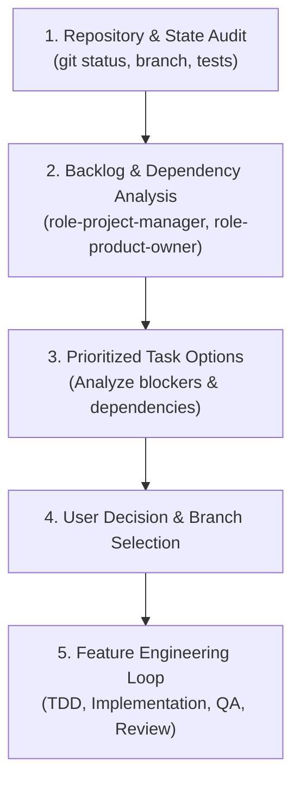

---
name: continue-project
description: >-
  Master entry point to resume work on an existing project. Audits repository
  state and git status, inspects recent commits and backlog issues, identifies
  blockers and dependencies, and proposes prioritized next tasks for user selection.
---

# `continue-project` Orchestrator Guide

This is the primary entry point whenever resuming work on an existing project. It eliminates guesswork by inspecting the current state of the codebase, analyzing blockers, and presenting the next best priorities for you to choose from.



---

## Step-by-Step Resume Sequence

### Step 1: Repository & Workspace Health Audit
1. Inspect the workspace:
   - Run `git status` to detect uncommitted changes or active branch.
   - Run `git log -n 5 --oneline` to review recent progress.
   - Verify if tests pass: `npm test` (or equivalent).
2. Check if a previous task was left midway or requires cleanup.

### Step 2: Backlog & Dependency Analysis
1. Read the project backlog (GitHub Issues, Kanban board, or `TODO.md` / `ROADMAP.md`).
2. Identify **Dependencies and Critical Path**:
   - Are there foundational dependencies that block downstream features? (e.g., Database schema / Auth session must exist before building the Profile or Settings screen).
   - Are there external blockers waiting on assets (e.g., Penpot wireframes)?
3. Evaluate effort vs value using [`role-project-manager`](../role-project-manager/SKILL.md) and [`role-product-owner`](../role-product-owner/SKILL.md).

### Step 3: Prioritized Proposal & Interactive Selection
Formulate a concise summary for the user presenting the top 2-3 logical next options:

```markdown
### Where We Left Off & Next Priorities

**Current Status**: On branch \`main\`, all tests passing, auth module completed.

**Recommended Next Actions**:
1. **[Recommended] Implement Mobile Bottom Navigation & Shell**:
   - *Why*: Critical path UI foundation needed before adding secondary views.
   - *Dependencies*: None.
   - *Estimated Effort*: Medium (1 session).
2. **Setup Local Database & User Preferences Store**:
   - *Why*: Unlocks offline data persistence for mobile users.
   - *Dependencies*: None.
   - *Estimated Effort*: Small-Medium.
3. **Configure Playwright Mobile E2E Smoke Tests**:
   - *Why*: Hardens the CI pipeline against layout regressions.
   - *Dependencies*: Shell UI.

*Which task would you like to tackle next, or do you have another priority in mind?*
```

### Step 4: Feature Execution Workflow
Once the user picks a direction:
1. **Branch**: Create and checkout a dedicated feature branch:
   ```bash
   git checkout -b feat/<task-name>
   ```
2. **Spec / RFC**: Draft quick acceptance criteria with [`role-product-owner`](../role-product-owner/SKILL.md).
3. **UI Polish**: Adhere to [`design-engineering`](../design-engineering/SKILL.md) (no AI slop, 48px tap targets, Penpot tokens).
4. **Implementation**: TDD implementation with frontend/backend role skills.
5. **Validation**: Test with [`role-qa-engineer`](../role-qa-engineer/SKILL.md) on mobile viewports.
6. **PR / Merge**: Open PR following [`standards-git-and-releases`](../standards-git-and-releases/SKILL.md).
