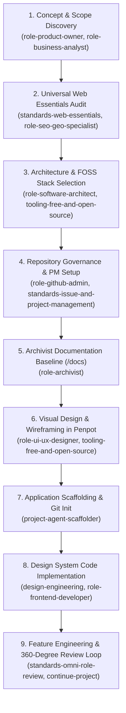

---
name: init-project
description: >-
  Master entry point to start and scaffold a new project from scratch. Elicits
  the product concept, guides mobile-first tech stack selection, audits universal
  web essentials, enforces 360-Degree-degree omni-role reviews, establishes project
  management governance, sets up archivist docs, coordinates visual Penpot design,
  scaffolds application skeletons, and guides atomic UI and feature implementation.
---

# `init-project` Orchestrator Guide

This is the primary entry point whenever starting a brand new project. It coordinates the specialized role skills into a seamless onboarding sequence.

---

## Step-by-Step Initialization Sequence

### Step 1: Product Concept & Scope Discovery
- Elicit the core vision, user personas, and target market or problem domain.
- Explicitly define MVP in-scope vs. out-of-scope boundaries.

### Step 2: Universal Web Essentials Audit (Boilerplate Features)
- **Mandatory Elicitation**: Audit project requirements against `standards-web-essentials`:
  - SEO: `sitemap.xml`, `robots.txt`, Open Graph social cards, JSON-LD schema.
  - Resilience: Custom 404, custom 500 error boundary, offline fallback, PWA manifest/favicons.
  - Governance: Privacy policy, terms of service, cookie notice, accessibility statement, security.txt, contact/correction form.
- Confirm with user which essentials are needed for MVP vs. future milestones.

### Step 3: Architecture & FOSS Stack Selection
- Apply the Dual-Recommendation policy (commercial benchmark vs. 100% free/FOSS alternative).
- Establish backend, database, mapping, and hosting strategies.

### Step 4: Repository Governance & Project Management Setup
- Setup issue templates (`.github/ISSUE_TEMPLATE/` for epics, features, tasks, bugs, ADRs).
- Configure PR template enforcing the **360-Degree Omni-Role Review Checklist** (`standards-omni-role-review`).
- Establish label taxonomy and milestones in GitHub Projects (v2).

### Step 5: Archivist Documentation Baseline (`/docs`)
- Initialize `/docs/adr/` with initial architectural decisions.
- Create `/docs/domain/` with framework-agnostic data models and calculation rules.
- Enforce local hard drive repository persistence (`<workspace>/docs/`).

### Step 6: Visual Design & Wireframing in Penpot (Zero Code)
- Establish visual typography, color palette, and spacing scale in Penpot.
- Wireframe entity profile cards, search and filter states, and map/list layouts for visual inspection and verification.
- Obtain design approval before translating into frontend code.

### Step 7: Application Scaffolding & Git Init
- Initialize repository, TypeScript configuration, and build pipeline.
- Configure database collections and schema migrations (Payload CMS).

### Step 8: Design System Code Implementation
- Translate approved Penpot tokens into Tailwind CSS config.
- Build reusable atomic UI component library (buttons, inputs, cards, badges) on top of the established application skeleton.

### Step 9: Feature Engineering & Omni-Role Review Loop
- Implement features via PRs, verifying each change against all perspectives (PO, BA, Legal, UX, UI, Dev, QA, Security, Perf, SEO, Copy, Archivist).
