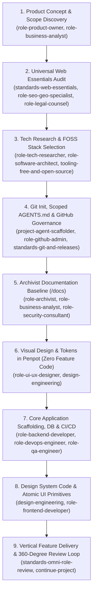

# `init-project` Master Onboarding & Scaffolding Orchestrator (`init-project`)

## Mission
Serve as the deterministic master entry point whenever starting a brand-new software project from scratch. Orchestrate all specialized role and governance skills in a strict, phase-gated sequence so that discovery, legal/SEO web essentials, FOSS architecture, living documentation (`/docs/`), and visual Penpot design tokens are locked **before** writing application feature code.

---

## Activation & Cross-Linking Protocol

Whenever `init-project` is activated:
1. **Enforce Sequential Lifecycle Gates (`project-lifecycle`)**:
   - Never jump straight from a 1-sentence user prompt to generating thousands of lines of unreviewed application code. Execute the 9 initialization steps below with explicit user checkpoints.
2. **Scaffold Project Extensions & Scoped Instructions (`Rule C` & `project-agent-scaffolder`)**:
   - Initialize `<workspace>/.agents/extensions/` and directory-scoped `AGENTS.md` files tailored to the project's chosen tech stack and domain.
3. **Enforce Hard Drive Persistence (`Rule D` & `role-archivist`)**:
   - Write all discovery artifacts, ADRs, domain models, and stack evaluations directly to `<workspace>/docs/` with `skills: [...]` YAML frontmatter.

---

## Step-by-Step Project Initialization Sequence

### Step 1: Product Concept, Personas & Scope Discovery
*Active Skills*: `role-product-owner`, `role-business-analyst`
- Elicit the problem statement, target personas, core Jobs-to-be-Done (JTBD), and domain entities (whether building an E-commerce marketplace, Healthcare patient portal, FinTech ledger, Civic directory, or B2B SaaS platform).
- Define strict **MVP In-Scope** vs. **Out-of-Scope (v2 Parking Lot)** boundaries.
- Persist initial product vision to `<workspace>/docs/research/01-product-vision-and-scope.md`.

### Step 2: Mandatory Universal Web Essentials Audit
*Active Skills*: `standards-web-essentials`, `role-seo-geo-specialist`, `role-legal-counsel`
- **Hard Gate Before Backlog Lock**: Walk the user through the `standards-web-essentials` catalogue and confirm MVP requirements for:
  - **Discovery & SEO**: Partitioned `sitemap.xml`, `robots.txt`, canonicals, dynamic `1200x630` Open Graph cards, Schema.org JSON-LD, and map-to-list crawl parity.
  - **Resilience & UX**: Custom `404` and `500` error boundaries, offline fallback, SVG/PWA favicons & `manifest.webmanifest`, and `/api/health` endpoint.
  - **Legal, Privacy & Trust**: Privacy Policy (`/privacy`), Terms of Service (`/terms`), cookieless analytics (`Umami`) or compliant consent banner, Accessibility Statement (`/accessibility` — EAA 2025), Methodology/Data Sourcing page, Contact/Rectification form (`/contact`), and `/.well-known/security.txt`.

### Step 3: Tech Research & FOSS Architecture Selection
*Active Skills*: `role-tech-researcher`, `role-software-architect`, `tooling-free-and-open-source`
- Present the **Dual-Recommendation Matrix** pairing commercial industry benchmarks with 100% Free & Open-Source alternatives (e.g., Next.js / Angular / Astro / SvelteKit, PostgreSQL + PostGIS / SQLite, Supabase / PocketBase / Payload CMS / Drizzle, MapLibre GL + OpenStreetMap, Cloudflare Pages / Coolify).
- Verify SPDX open-source license compatibility and zero-cost local `docker compose` reproducibility.
- Ask the user once (per `Rule F` of `standards-skills-governance`) whether they want AI co-authorship trailers enabled in Git commits, defaulting strictly to **No** if declined or unprompted.

### Step 4: Repository Initialization, Scoped `AGENTS.md` & GitHub Governance
*Active Skills*: `project-agent-scaffolder`, `role-github-admin`, `standards-issue-and-project-management`, `standards-git-and-releases`
- Initialize Git (`git init -b main`), `.gitignore`, and `.env.example`.
- Execute `project-agent-scaffolder` to generate root `AGENTS.md`, scoped subdirectory `AGENTS.md` files (`src/app/`, `src/server/`, `src/shared/`, `tests/`), and starter delta files under `<workspace>/.agents/extensions/<skill-name>.md`.
- Install `.github/ISSUE_TEMPLATE/*.yml` forms and `.github/pull_request_template.md` enforcing the 14-role `standards-omni-role-review` checklist.
- Provision labels, milestones, and the initial dependency-ordered backlog in GitHub Issues / Projects (v2).

### Step 5: Archivist Living Documentation Baseline (`/docs/`)
*Active Skills*: `role-archivist`, `role-business-analyst`, `role-software-architect`, `role-security-consultant`
- Initialize `<workspace>/docs/` with YAML frontmatter cross-linking (`skills: [...]`):
  - `/docs/README.md` (Master index)
  - `/docs/adr/0001-record-architecture-decisions.md` & `/docs/adr/0002-tech-stack-selection.md`
  - `/docs/domain/glossary.md` & `/docs/domain/data-dictionary.md` (Entities, invariants, GDPR Art. 6 lawful bases)
  - `/docs/architecture/system-overview-c4.md`, `/docs/architecture/api-contracts.md`, and `/docs/architecture/security-threat-model.md`.

### Step 6: Visual Design & Tokens in Penpot (Zero Feature Code Gate)
*Active Skills*: `role-ui-ux-designer`, `design-engineering`
- Establish semantic design tokens (`OKLCH` color ramps for light/dark modes, fluid typography scale, `4px/8px` spatial rhythm, radii, elevation) and mobile-first wireframes (`390x844` first, then desktop) in **Penpot 2.x** (or document token specifications in `/docs/architecture/design-tokens.md`).
- Design all **8 Mandatory UI States** (Loading, Empty, Partial, Ideal, Overflow, Error, Offline, Permission Denied) and verify WCAG 2.2 AA contrast and `>= 48x48px` touch targets before writing feature UI code.

### Step 7: Core Technical Scaffolding, Database & CI/CD Pipeline
*Active Skills*: `role-backend-developer`, `role-devops-engineer`, `role-qa-engineer`, `standards-code-style`
- Scaffold the application skeleton with TypeScript strict mode (`strict: true`, `noUncheckedIndexedAccess: true`), translate the universal baseline rules from `standards-code-style` into project-level ESLint/Biome/Prettier/Stylelint configurations, and set up Commitlint and local `docker-compose.yml`.
- Configure database schema migrations, seed data scripts, structured PII-redacting logger, and `/api/health` readiness endpoint.
- Configure GitHub Actions CI workflow running typecheck, lint, unit tests (Vitest), and Playwright mobile/desktop E2E + `@axe-core/playwright` accessibility checks.

### Step 8: Design System Code Implementation (Tokens & Atomic Primitives)
*Active Skills*: `design-engineering`, `role-frontend-developer`, `role-copywriter`
- Translate approved Penpot design tokens into CSS custom properties / Tailwind CSS `@theme` configuration.
- Implement accessible, keyboard-navigable atomic UI primitives (`Button`, `Input`, `Select`, `Dialog/Sheet`, `Badge`, `Card`, `Skeleton`, `EmptyState`, `ErrorBoundary`) with `48x48px` tap targets, `tabular-nums`, and compositor-only motion.

### Step 9: Vertical Feature Delivery & 360-Degree Review Loop
*Active Skills*: `continue-project`, `standards-omni-role-review`, `role-senior-code-reviewer`
- Transition into iterative vertical feature delivery (`continue-project`), executing each backlog issue on a dedicated feature branch with TDD, Playwright mobile verification, `/docs/` synchronization, and full 14-role PR review.

---

## Mandatory `init-project` Gate Checklist

- [ ] **Phase Discipline Maintained**: Zero feature code written prior to locking product scope, Web Essentials, ADRs, domain glossary, and design tokens.
- [ ] **Web Essentials Tracked**: All selected `standards-web-essentials` items exist as tracked backlog issues.
- [ ] **Hard Drive Docs Persisted**: `/docs/README.md`, `/docs/adr/`, `/docs/domain/`, and `/docs/architecture/` are committed to Git with `skills:` frontmatter.
- [ ] **Scoped Agent Rules Installed**: Root `AGENTS.md`, subdirectory `AGENTS.md` files, and `.agents/extensions/` are scaffolded cleanly.
- [ ] **CI & Quality Baseline Green**: Initial skeleton compiles, passes unit + Playwright mobile/accessibility smoke tests, and adheres to `standards-git-and-releases`.

---

## Continuous Evolution & Self-Improvement Mandate
- **Baseline Floor, Not a Ceiling**: Adapt the depth of each initialization phase to the complexity and regulatory criticality of the target domain, capturing bespoke project onboarding steps in `<workspace>/.agents/extensions/` and `/docs/guide/local-development.md`.
