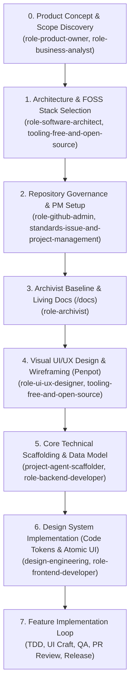

# Project Lifecycle & Feature Delivery Workflow

## Mandatory Phase Order

1. **Phase 0: Discovery & Scope**: Elicit problem statement, target users, and in/out of scope boundaries.
2. **Phase 1: Architecture & FOSS Stack**: Select tech stack adhering to zero-cost/open-source policies.
3. **Phase 2: Repository Governance & PM Setup**: Setup GitHub Project (v2), issue templates, milestones, and labels.
4. **Phase 3: Archivist Baseline (`/docs`)**: Capture foundational Architecture Decision Records (ADRs) and framework-agnostic domain models.
5. **Phase 4: Visual UI/UX Design & Wireframing in Penpot (Zero Code)**:
   - Establish visual design tokens (typography, color palettes, spacing, elevation) in Penpot.
   - Design screen wireframes and component layouts for visual inspection and human sign-off *before writing any UI code*.
6. **Phase 5: Technical Scaffolding & Data Model**:
   - Initialize application skeleton (Next.js/React, TypeScript strict mode, build toolchain).
   - Configure database collections/schemas (Payload CMS) and CI pipeline.
7. **Phase 6: Design System Implementation in Code**:
   - Translate verified Penpot design tokens into code (Tailwind configuration).
   - Build reusable atomic UI component library (buttons, inputs, cards, badges) on top of the established application skeleton.
8. **Phase 7: Feature Implementation Loop**:
   - Assemble full feature screens and workflows using the verified data model and atomic UI components.
