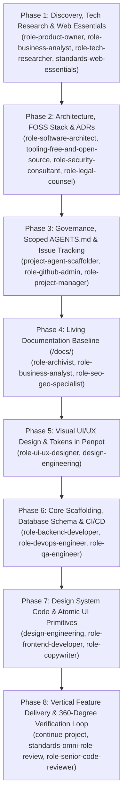

# Master Project Lifecycle & Phase-Gate Progression Guide (`project-lifecycle`)

## Mission
Enforce a disciplined, sequential, 8-phase engineering lifecycle with explicit Entry Criteria, Deliverables, and Exit Gates for every stage. Prevent the catastrophic anti-pattern of writing ad-hoc application code before domain invariants, legal/SEO essentials, system architecture, living documentation, and visual design tokens are established.

---

## Activation & Cross-Linking Protocol

Whenever `project-lifecycle` is referenced:
1. **Load Project Extensions (Rule C)**:
   - Check `<workspace>/.agents/extensions/project-lifecycle.md` for project-specific release gates, regulatory sign-offs, or custom deployment environments.
2. **Coordinate Master Orchestrators (Rule D)**:
   - New repositories enter through [`init-project`](file:///d:/project-lifecycle-skills/init-project/SKILL.md) (Phases 1–7).
   - Existing repositories enter through [`continue-project`](file:///d:/project-lifecycle-skills/continue-project/SKILL.md) (auditing current phase readiness and executing Phase 8 delivery loops).

---

## The 8 Mandatory Lifecycle Phases & Exit Gates

### Phase 1: Discovery, Tech Research & Web Essentials Audit
- **Governing Skills**: `role-product-owner`, `role-business-analyst`, `role-tech-researcher`, `standards-web-essentials`
- **Core Activities**:
  - Elicit problem statement, user personas, Jobs-to-be-Done (JTBD), and MVP vs. out-of-scope boundaries across the target domain (e.g., Healthcare, E-commerce, FinTech, Civic/GovTech, SaaS).
  - Conduct time-boxed technical spikes and competitive UX benchmarks.
  - Complete the mandatory **`standards-web-essentials`** 18-item audit (`sitemap.xml`, `robots.txt`, 404/500 pages, Privacy/Terms/Accessibility pages, `security.txt`, contact/dispute channels).
- **Hard Exit Gate**: Product scope and Web Essentials matrix persisted in `/docs/research/` and confirmed by the user.

### Phase 2: Architecture, FOSS Stack Selection & ADRs
- **Governing Skills**: `role-software-architect`, `tooling-free-and-open-source`, `role-security-consultant`, `role-legal-counsel`
- **Core Activities**:
  - Select the technology stack applying the **Dual-Recommendation FOSS Policy** ($0 licensing cost baseline, SPDX license verification, zero vendor lock-in).
  - Define module boundaries, authentication/authorization model, GDPR Art. 6 lawful bases for PII, and threat model.
- **Hard Exit Gate**: Foundational Architecture Decision Records committed to `/docs/adr/`.

### Phase 3: Repository Governance, Scoped `AGENTS.md` & Issue Tracking
- **Governing Skills**: `project-agent-scaffolder`, `role-github-admin`, `role-project-manager`, `standards-issue-and-project-management`, `standards-git-and-releases`
- **Core Activities**:
  - Scaffold root `AGENTS.md`, directory-scoped `AGENTS.md` files (`src/app/`, `src/server/`, `src/shared/`, `tests/`), and `.agents/extensions/<skill-name>.md`.
  - Configure `.github/ISSUE_TEMPLATE/*.yml`, `.github/pull_request_template.md`, label taxonomy, milestones, and GitHub Projects (v2) Kanban board.
  - Populate the dependency-ordered backlog with vertically sliced issues (`XS`/`S`/`M`) that pass the `standards-omni-role-review` refinement check.
- **Hard Exit Gate**: Backlog issues created, sized, labeled, and linked to milestones; scoped `AGENTS.md` hierarchy committed.

### Phase 4: Living Documentation Baseline (`/docs/`)
- **Governing Skills**: `role-archivist`, `role-business-analyst`, `role-software-architect`, `role-seo-geo-specialist`
- **Core Activities**:
  - Author framework-agnostic domain documentation in `/docs/domain/` (Ubiquitous Language glossary, ERD, data dictionary, state machines, deterministic calculation rules).
  - Author `/docs/architecture/api-contracts.md` and URL/SEO hierarchy specifications.
  - Tag all `/docs/**/*.md` files with `skills: [...]` YAML frontmatter (`Rule D`).
- **Hard Exit Gate**: Complete `/docs/README.md` index with zero ephemeral-only specifications remaining in chat scratchpads.

### Phase 5: Visual UI/UX Design & Design Tokens in Penpot (Zero Code Gate)
- **Governing Skills**: `role-ui-ux-designer`, `design-engineering`, `role-copywriter`
- **Core Activities**:
  - Establish three-tier semantic design tokens (`OKLCH` light/dark color system, fluid typography scale, `4px/8px` spatial grid, radii, elevation) and mobile-first wireframes (`390x844` first, then `1440x900`) in **Penpot 2.x**.
  - Design all **8 Mandatory UI States** (Loading, Empty, Partial, Ideal, Overflow, Error, Offline, Permission Denied) and verify WCAG 2.2 AA contrast and `>= 48x48px` tap targets.
- **Hard Exit Gate**: Visual design tokens and screen layouts signed off before writing application UI components.

### Phase 6: Core Scaffolding, Database Migrations & CI/CD Pipeline
- **Governing Skills**: `role-backend-developer`, `role-devops-engineer`, `role-qa-engineer`, `role-security-consultant`
- **Core Activities**:
  - Initialize application skeleton (e.g., Next.js, Angular, Vue/Nuxt, SvelteKit, Astro, or Node/Go/Python API) with strict TypeScript (`strict: true`, `noUncheckedIndexedAccess: true`), linting, and `docker-compose.yml`.
  - Implement core database schemas, versioned migrations, seed scripts, PII-scrubbing structured logger, security headers (CSP), and `/api/health` readiness endpoint.
  - Configure GitHub Actions CI pipeline executing typecheck, lint, Vitest unit tests, and Playwright mobile/desktop E2E + `@axe-core/playwright` accessibility checks.
- **Hard Exit Gate**: CI pipeline is green on `main` against the scaffolded skeleton and database.

### Phase 7: Design System Code Implementation (Tokens & Atomic UI)
- **Governing Skills**: `design-engineering`, `role-frontend-developer`, `role-qa-engineer`
- **Core Activities**:
  - Translate approved Penpot tokens into CSS custom properties / Tailwind CSS `@theme` configuration.
  - Build and test reusable, accessible atomic UI components (`Button`, `Input`, `Dialog`, `Drawer`, `Card`, `Badge`, `Skeleton`, `EmptyState`, `ErrorBoundary`) with `tabular-nums`, `text-wrap: balance/pretty`, `48x48px` touch targets, and compositor-only animations (`transform`, `opacity`).
- **Hard Exit Gate**: Atomic UI primitives verified across light/dark modes, mobile viewports, and `axe-core` WCAG 2.2 AA checks.

### Phase 8: Iterative Vertical Feature Delivery & 360-Degree Verification Loop
- **Governing Skills**: `continue-project`, `standards-omni-role-review`, `role-senior-code-reviewer`, `role-qa-engineer`, `role-archivist`
- **Core Activities**:
  - Pull the top `Ready for Dev` issue along the critical path -> create `feat/<id>-<slug>` branch -> implement backend + frontend + all 8 UI states via TDD -> run Playwright mobile/desktop E2E & accessibility suite -> update `/docs/` -> run the 14-role `standards-omni-role-review` and Staff PR code review checklist -> squash-merge to `main`.
- **Hard Exit Gate**: All acceptance criteria met, zero `[blocking]` review findings, CI green, `/docs/` synchronized, and issue closed.

---

## Anti-Skip Governance Rules

- **Never Skip Phase 1–2**: Writing code before running the `standards-web-essentials` audit and locking ADRs results in missing legal/SEO foundations and costly architectural rewrites.
- **Never Skip Phase 4**: Leaving domain models only in chat memory violates the Hard Drive Persistence Mandate (`Rule D`) and causes context loss across sessions.
- **Never Skip Phase 5 & 7**: Writing ad-hoc page layouts without a token system and atomic UI library produces inconsistent "AI UI slop" and broken mobile ergonomics.

---

## Continuous Evolution & Self-Improvement Mandate
- **Baseline Floor, Not a Ceiling**: This 8-phase progression is the foundational engineering lifecycle floor. Continuously refine phase exit criteria for the active project in `<workspace>/.agents/extensions/project-lifecycle.md` and upstream universal lifecycle improvements into this skill.
