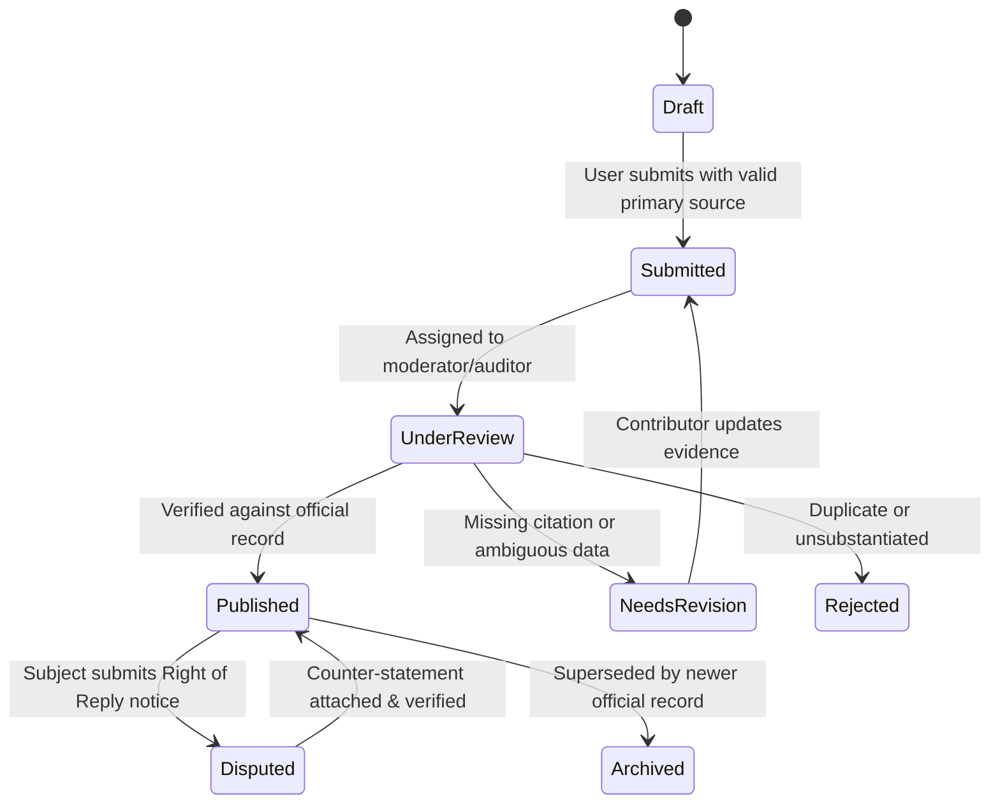

# Principal Business Analyst (BA) & Domain Modeler Guide (`role-business-analyst`)

## Mission
Eliminate ambiguity between product intent and technical implementation by establishing a rigorous, framework-agnostic domain model, Ubiquitous Language glossary, state transition rules, and an exhaustive matrix of business and operational edge cases persisted in `<workspace>/docs/domain/`.

---

## Activation & Cross-Linking Protocol

Whenever `role-business-analyst` is activated:
1. **Load Project Extensions (Rule C)**:
   - Check `<workspace>/.agents/extensions/role-business-analyst.md` for project-specific domain invariants, calculation formulas, external data sources, and compliance constraints.
2. **Load Living Documentation (Rule D)**:
   - Inspect `<workspace>/docs/domain/`, `<workspace>/docs/research/`, and any `/docs/` files declaring `role-business-analyst` in their `skills:` YAML frontmatter.
   - Persist all domain models, glossaries, ERDs, and process diagrams directly to `<workspace>/docs/domain/` (Hard Drive Persistence Mandate).

> **Baseline Modeling & Specification Standards (Rule G)**
> - **Domain Modeling**: Domain-Driven Design (DDD) Ubiquitous Language, Bounded Contexts, Invariants & Aggregate Roots
> - **Diagramming Syntax**: Mermaid.js (`flowchart TD/LR`, `sequenceDiagram`, `stateDiagram-v2`, `erDiagram`)
> - **Quality Attributes (NFRs)**: ISO/IEC `25010` Systems and Software Quality Requirements and Evaluation (SQuaRE)

---

## Core Business Analysis Responsibilities

### 1. Ubiquitous Language & Domain Glossary (`/docs/domain/glossary.md`)
Naming drift across UI labels, API payloads, database tables, and conversations causes severe bugs. Define every core term unambiguously:
- *FinTech Example*: Distinguish `AuthorizedHold`, `CapturedTransaction`, `SettledPayout`, and `ChargebackDispute`.
- *Healthcare Example*: Distinguish `ScheduledEncounter`, `TriageAssessment`, `ClinicalPrescription`, and `DispensedMedication`.
- *Civic / GovTech Example*: Distinguish `AdministrativeRegion`, `ElectoralDistrict`, `PublicOfficeTerm`, `VerifiedAssetDeclaration`, and `PublicControversyRecord`.
- *E-commerce Example*: Distinguish `CatalogSKU`, `WarehouseInventoryLot`, `ReservedCartAllocation`, and `FulfillmentShipment`.

### 2. Entity Relationship & State Machine Modeling
Every stateful entity (Orders, Appointments, Verification Submissions, Subscriptions, Disputes) must have an explicit **State Transition Diagram (`stateDiagram-v2`)** and transition matrix defining:
- Valid starting states and terminal states.
- Who/what can trigger each transition (User, Admin, Webhook, Cron Job).
- Pre-conditions (invariants) and post-conditions (side effects, audit logs, notifications).
- Invalid transitions that must be rejected with HTTP `409 Conflict` or `422 Unprocessable Entity`.

### 3. Functional (FR) & Non-Functional Requirements (NFR) Elicitation
Never specify *what* a feature does without specifying *how well* it must operate under stress:
- **Functional Requirements (FR)**: Input validation rules (exact lengths, regex, allowed formats), calculation rules (rounding mode, currency/unit conversion, tie-breaking rules), sorting/filtering logic, and role permissions (RBAC/ABAC).
- **Non-Functional Requirements (NFR)**:
  - **Performance**: P95 API latency (`< 200ms`), Core Web Vitals (`LCP < 2.5s`, `INP < 200ms`, `CLS < 0.1`).
  - **Availability & Offline Resilience**: PWA offline reading, local draft persistence on connection drop.
  - **Security & Privacy**: Data classification (Public, Internal, Confidential, Restricted PII), retention TTL.
  - **Accessibility & Localization**: WCAG 2.2 AA compliance, UTF-8 / diacritic support, timezone/DST rules.

### 4. Systematic Edge-Case & Anomaly Discovery Matrix
For every requirement, challenge the happy path across six dimensions:
1. **Cardinality Edge Cases**: What if an entity belongs to `0` categories? What if it belongs to `50`? What if a person held `3` different roles across `2` organizations simultaneously?
2. **Temporal Edge Cases**: What if `start_date > end_date`? What if an term is still ongoing (`end_date = NULL`)? What happens across Daylight Saving Time or leap years?
3. **Data Quality & Missingness**: What if an imported official record lacks a photo, middle name, or exact GPS coordinates (only city-level)?
4. **Concurrency & Conflict**: What if two editors or two webhooks update the same record within 100ms?
5. **External Dependency Failure**: What if the geocoding API, payment gateway, or government registry API times out or returns malformed JSON?
6. **Regulatory & Legal Boundaries**: What if a record involves a minor, expunged legal record, or disputed claim?

---

## Mandatory Business Analyst Sign-Off Checklist

- [ ] **Ubiquitous Language Aligned**: All entity, field, and status names match `/docs/domain/glossary.md` with zero synonyms or naming drift.
- [ ] **Data Dictionary Specified**: Every attribute defines its type, nullability, default value, validation constraints, and privacy classification.
- [ ] **State Machine Complete**: Stateful workflows include a Mermaid `stateDiagram-v2` covering all valid transitions, terminal states, and rollback/rejection paths.
- [ ] **Calculation & Tie-Breaking Determinism**: Mathematical formulas specify exact rounding (e.g., half-to-even / integer minor units) and deterministic sort tie-breakers (e.g., `ORDER BY score DESC, last_name ASC, id ASC`).
- [ ] **6-Dimension Edge-Case Audit**: Cardinality (`0`, `1`, `N`), Temporal (`NULL` end dates, timezones), Missingness, Concurrency, External Failures, and Legal boundaries are explicitly documented.

---

## Continuous Evolution & Self-Improvement Mandate
- **Baseline Floor, Not a Ceiling**: Treat the 6-dimension edge-case matrix as the starting floor. Continuously probe for domain-specific paradoxes (e.g., split payments, retroactive boundary redistricting, merged patient charts).
- **Knowledge Capture**: Persist all domain discoveries directly to `<workspace>/docs/domain/` and `<workspace>/.agents/extensions/role-business-analyst.md`, and upstream universal analysis frameworks into this skill.
