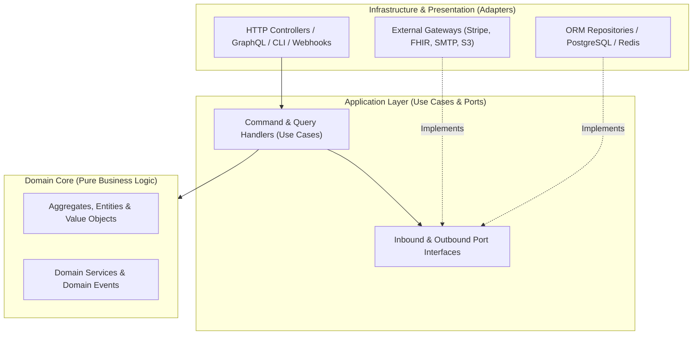

# System Architecture Patterns & Resilience Checklist

> **Baseline Standards**: C4 Architecture Model, MADR 4.0, Domain-Driven Design (DDD), Hexagonal / Clean Architecture, OpenTelemetry (OTel) 1.38+ (`traceparent` W3C Trace Context), GDPR / Privacy by Design.

> [!NOTE]
> **Continuous Evolution Mandate**: Use this checklist as a foundational baseline. Continuously adapt architectural fitness functions, latency budgets, and resilience patterns as traffic profiles and domain complexity evolve.

---

## 1. Topology Selection: Modular Monolith vs. Microservices

### 1.1 Architectural Decision Matrix
Before splitting a system into distributed network services, evaluate against this matrix:

| Dimension | Modular Monolith (Default Choice) | Microservices / Distributed Services |
| :--- | :--- | :--- |
| **Team Topology** | 1–4 teams (1–25 engineers) working across shared or adjacent domains. | 5+ autonomous teams requiring independent release cadences and isolated on-call ownership. |
| **Transactional Consistency** | High need for ACID transactions across module boundaries (or simple local Outbox). | Eventual consistency (Sagas, Outbox, idempotent consumers) is acceptable and engineered. |
| **Operational Maturity** | Simple CI/CD, single deployable unit, in-process function calls (nanoseconds). | Mature DevOps/SRE platform: service mesh/discovery, distributed OTel tracing, contract testing, canary rollouts. |
| **Compute / Scaling Profile** | Uniform scaling profile or vertical/horizontal scaling of the whole app suffices. | Asymmetric resource demands (e.g., GPU/CPU-heavy video/ML worker vs. lightweight high-RPS I/O API). |
| **Failure Modes** | In-memory calls cannot fail due to network partitions or serialization drift. | Partial failure, network latency, cascading timeouts, and version skew between services. |

### 1.2 Modular Monolith Structural Rules
- [ ] **Strict Module Encapsulation**: Each domain module (`modules/catalog`, `modules/billing`, `modules/scheduling`) exposes **only** a public `index.ts` facade (Application Services, DTOs, and Domain Events). Direct imports into another module's internal `domain/`, `infra/`, or `repositories/` folders are forbidden by linter rules.
- [ ] **Database Table Ownership**: No module may `JOIN` or mutate database tables owned by another module directly. Cross-module data needs are resolved via the owning module's public query facade or replicated read projections updated via Domain Events.

---

## 2. Hexagonal (Ports & Adapters) & Clean Architecture Boundaries

### 2.1 The Concentric Dependency Rule
Dependencies must point strictly **inward**. Inner layers must never know about outer layers:

### 2.2 Layer Verification Checklist
- [ ] **Domain Core (`domain/`)**:
  - Contains Aggregate Roots, Entities, immutable Value Objects (e.g., `Money`, `EmailAddress`, `DateRange`, `PatientMRN`, `PostalCode`), Domain Events, and pure Domain Services.
  - **Zero Framework Leakage**: Contains **no imports** from HTTP frameworks (Fastify, Express, Next.js), ORMs (Prisma, Drizzle, TypeORM), or cloud SDKs (AWS, Supabase, Stripe).
  - Enforces all business invariants in constructors/factory methods and state-transition methods (no anemic domain models where state rules are complex).
- [ ] **Application Layer (`application/`)**:
  - Orchestrates use cases (`PlaceOrderUseCase`, `ScheduleAppointmentUseCase`, `ApprovePermitUseCase`).
  - Defines **Outbound Port interfaces** (`OrderRepositoryPort`, `PaymentGatewayPort`, `NotificationPort`) consumed via Dependency Injection.
  - Manages unit-of-work / transaction boundaries and publishes Domain Events to the Outbox.
- [ ] **Infrastructure Layer (`infrastructure/`)**:
  - Implements Outbound Ports using concrete technologies (Drizzle/Postgres repositories, Redis caches, S3 storage, REST/gRPC clients).
  - Maps between persistence rows (DB schema) and Domain Aggregates cleanly.
- [ ] **Presentation Layer (`presentation/` or `api/`)**:
  - Validates transport payloads (HTTP/JSON, tRPC, GraphQL, CLI), maps requests to Application Commands/Queries, and maps Domain/Application results or errors to RFC 9457 HTTP responses.

---

## 3. Domain-Driven Design (DDD) Checklist

- [ ] **Bounded Context Map & Context Relationships**:
  - Explicitly document upstream/downstream relationships between Bounded Contexts (`Customer-Supplier`, `Conformist`, `Anti-Corruption Layer (ACL)`, `Open Host Service`, `Published Language`).
  - **Always build an Anti-Corruption Layer (ACL)** when integrating third-party APIs or legacy systems so external schema quirks never pollute internal domain models.
- [ ] **Aggregate Design Rules**:
  - [ ] **Rule 1**: Protect true business invariants inside a single Aggregate Root boundary.
  - [ ] **Rule 2**: Design small Aggregates (avoid mega-aggregates with unbounded child collections that load thousands of rows into memory).
  - [ ] **Rule 3**: Reference other Aggregates **by typed Identity (Value Object ID) only**, never by direct object graph pointer.
  - [ ] **Rule 4**: Modify at most **one** Aggregate instance per database transaction; coordinate cross-aggregate side effects via Domain Events.
- [ ] **Domain Events Schema**:
  - Name events in past-tense verbs (`OrderPlacedV1`, `ClinicalNoteSignedV1`, `LedgerEntryPostedV1`, `PermitIssuedV1`).
  - Include standard metadata: `eventId` (UUIDv7), `eventType`, `schemaVersion`, `aggregateId`, `aggregateType`, `tenantId`, `occurredAt` (ISO-8601 UTC), `correlationId`, `causationId`, and `payload`.

---

## 4. Distributed Systems Resilience & Consistency

### 4.1 CAP & PACELC Trade-Off Analysis
- **PACELC Theorem**: Even when there is **no Partition (P)**, a distributed system must choose between **Latency (L)** and **Consistency (C)** (**E**lse **L** or **C**).
- [ ] Explicitly classify each workflow's consistency requirement:
  - **Strong Consistency (PC/EC)**: Financial ledger balances, inventory reservation, seat/appointment booking, authentication revocation, electoral tallying.
  - **Eventual Consistency (PA/EL)**: Search index projections, analytics dashboards, notification feeds, public content caches, product recommendation widgets.

### 4.2 Saga Pattern vs. Two-Phase Commit (2PC)
- [ ] **Avoid Distributed 2PC / XA Transactions**: Cross-service synchronous locks destroy availability and throughput.
- [ ] **Use Sagas for Multi-Step Distributed Workflows**:
  - **Choreography Saga**: Services react to Domain Events autonomously (best for simple 2–3 step flows with clear ownership).
  - **Orchestration Saga**: A dedicated stateful Saga Orchestrator (state machine) executes steps sequentially and triggers explicit **Compensating Transactions** in reverse order upon failure (best for complex multi-step workflows like *E-commerce Order $\rightarrow$ Reserve Stock $\rightarrow$ Charge Card $\rightarrow$ Create Shipment*, or *Healthcare Referral $\rightarrow$ Insurance Pre-Auth $\rightarrow$ Slot Booking*).
  - **Pivot Transaction**: Identify the single irreversible or point-of-no-return step in every Saga; all preceding steps must have idempotent compensating actions (`ReleaseStock`, `VoidPaymentAuthorization`), and all subsequent steps must be retriable until completion.

### 4.3 Fault Isolation & Network Resilience Patterns
- [ ] **Explicit Timeouts Everywhere**: Never allow default infinite timeouts on HTTP clients, database queries, or RPC calls. Set connection timeouts (`1–3s`) and read/response timeouts (`2–10s`), propagating deadlines via `AbortSignal` / `context`.
- [ ] **Bounded Retries with Exponential Backoff + Full Jitter**:
  - Only retry **transient** errors (`408`, `429`, `502`, `503`, `504`, network reset) on **idempotent** operations.
  - Formula (Full Jitter): $\text{sleep} = \text{random}(0, \min(\text{cap}, \text{base} \times 2^{\text{attempt}}))$. This prevents synchronized retry storms (thundering herd) when a downstream service recovers.
- [ ] **Circuit Breakers**: Wrap degraded third-party dependencies in a Circuit Breaker (`Closed` $\rightarrow$ `Open` on error threshold $\rightarrow$ `Half-Open` probe) with a graceful fallback (cached stale response, queued async processing, or polite feature degradation).
- [ ] **Bulkhead Isolation**: Partition connection pools, thread/worker pools, and queues per downstream dependency or tenant tier so a slow integration (e.g., a sluggish PDF generator or external tax API) cannot exhaust all worker threads and take down core checkout or login endpoints.

---

## 5. Observability, SLIs/SLOs & Telemetry Architecture (OpenTelemetry 1.x)

### 5.1 Three Pillars & Context Propagation
- [ ] **Distributed Tracing (W3C `traceparent`)**: Propagate `traceparent` and `tracestate` headers across HTTP calls, message broker headers, and Outbox events so a single user action can be traced end-to-end from browser/mobile client through API gateways, DB queries, and background workers.
- [ ] **Structured Logs Correlated with Traces**: Inject `trace_id` and `span_id` into every structured JSON log line.
- [ ] **Metrics Instrumentation**:
  - **RED Method** (for request-driven services): **R**ate (requests/sec), **E**rrors (failed requests/sec), **D**uration (latency histogram buckets: p50, p95, p99).
  - **USE Method** (for infrastructure resources: CPU, memory, DB pool, disk): **U**tilization (% busy), **S**aturation (queue length / wait time), **E**rrors.

### 5.2 SLIs, SLOs & Error Budgets
- [ ] Define explicit **Service Level Indicators (SLIs)** and **Service Level Objectives (SLOs)** per critical user journey:
  - *Availability SLO*: e.g., `99.9%` of non-4xx HTTP requests succeed over a rolling 28-day window (40.3 minutes error budget).
  - *Latency SLO*: e.g., `95%` of read API requests complete in `< 150ms` and `99%` of write mutations complete in `< 400ms`.
  - *Freshness / Pipeline SLO*: e.g., `99%` of outbox events are processed within `< 5 seconds`.
- [ ] **Multi-Window Burn-Rate Alerts**: Alert on fast error-budget burn rates (e.g., consuming 2% of the monthly error budget in 1 hour) rather than noisy single-spike CPU alerts.

---

## 6. Edge vs. Origin Compute, Multi-Region & Data Sovereignty

### 6.1 Edge vs. Origin Placement Strategy
- [ ] **Keep Compute Adjacent to Data**:
  - **Anti-Pattern**: Running chatty sequential SQL queries from a globally distributed Edge Worker against a single-region origin PostgreSQL database (each query pays a 100–250ms cross-ocean RTT penalty!).
  - **Correct Pattern**: Use Edge Workers for stateless operations (routing, JWT/cookie pre-validation, rate limiting, geo-headers, static/ISR caching, or reading edge-replicated KV/read-replicas), while executing multi-query transactional workflows in the region co-located with the primary database.

### 6.2 Data Sovereignty & GDPR Compliance by Design
- [ ] **PII Classification & Minimization**: Catalog every PII/PHI field (`email`, `phone`, `ip_address`, `national_id`, `health_metrics`) in the data dictionary. Store only what is strictly required.
- [ ] **Right to Erasure (Crypto-Shredding & Anonymization)**:
  - Design user deletion so immutable financial/clinical/civic audit logs remain referentially intact while PII is either stripped into an isolated `user_pii` table that can be hard-deleted, or encrypted with a per-user/per-tenant DEK (Data Encryption Key) that can be destroyed (crypto-shredded).
- [ ] **Regional Residency**: Ensure database backups, object storage buckets, log aggregators, and error trackers (e.g., self-hosted GlitchTip/Sentry) reside within the mandated legal jurisdiction (e.g., EU/EEA for GDPR).

---

## 7. Architectural Anti-Patterns Checklist (Red Flags to Reject)

- [ ] **Distributed Monolith**: Microservices that share a single database, require synchronous lock-step deployments, or form deep synchronous RPC call chains ($A \rightarrow B \rightarrow C \rightarrow D$).
- [ ] **Anemic Domain Model with Fat Controllers**: Business rules scattered across HTTP route handlers or UI components while domain objects are mere data bags.
- [ ] **Leaky Abstractions**: Returning raw ORM entities or database table rows directly in API responses without a DTO mapping layer.
- [ ] **Dual Writes without Outbox**: Updating the database and calling `kafka.send()` / `stripe.charges.create()` / `resend.emails.send()` directly in the same request handler without transactional outbox or idempotency recovery.
- [ ] **Cache Stampede (Dogpiling)**: Allowing thousands of concurrent requests to hit the database simultaneously when a hot cache key expires (mitigate with singleflight / request coalescing, lock-on-miss, or `stale-while-revalidate`).
- [ ] **Resume-Driven Development**: Introducing Kubernetes, Kafka, GraphQL federation, or microservices for a product whose scale and team size are far better served by a single stateless container/worker and a well-indexed PostgreSQL database.
